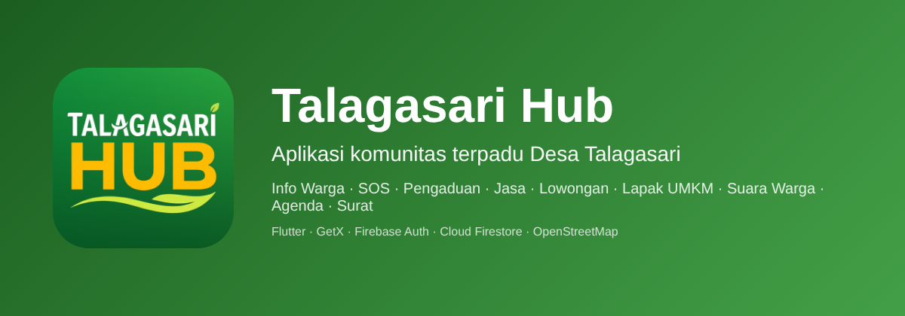
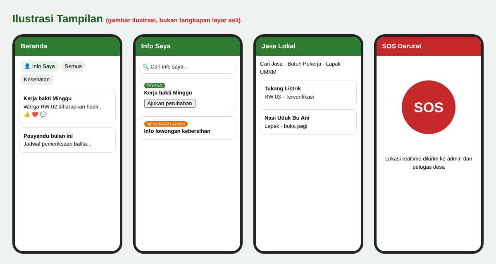

<p align="center">
  
</p>

<h1 align="center">Talagasari Hub</h1>

<p align="center">
  Aplikasi komunitas terpadu untuk warga <b>Desa Talagasari, Kecamatan Cikupa, Kabupaten Tangerang, Banten</b>.<br>
  Informasi desa, SOS darurat, pengaduan, layanan jasa lokal, lowongan, lapak UMKM, suara warga, agenda, dan surat online dalam satu aplikasi.
</p>

<p align="center">
  
  
  
  
  
  
  
</p>

> Proyek ini dibuat sebagai bagian dari skripsi. Backend hanya memakai **Firebase Authentication** dan **Cloud Firestore** (paket gratis Spark). Tanpa Firebase Storage, tanpa Cloud Functions, tanpa API key peta.

---

## Daftar Isi

1. [Tampilan Aplikasi](#1-tampilan-aplikasi)
2. [Fitur Lengkap](#2-fitur-lengkap)
3. [Peran Pengguna](#3-peran-pengguna)
4. [Arsitektur](#4-arsitektur)
5. [Struktur Proyek](#5-struktur-proyek)
6. [Instalasi dan Menjalankan](#6-instalasi-dan-menjalankan)
7. [Konfigurasi Firebase](#7-konfigurasi-firebase)
8. [Membuat Akun Admin dan Kades](#8-membuat-akun-admin-dan-kades)
9. [Alur Kerja Fitur](#9-alur-kerja-fitur)
10. [Aturan Komunitas](#10-aturan-komunitas)
11. [Koleksi Firestore](#11-koleksi-firestore)
12. [Izin Android](#12-izin-android)
13. [Build APK](#13-build-apk)
14. [Skenario Uji Cepat](#14-skenario-uji-cepat)
15. [Pemecahan Masalah](#15-pemecahan-masalah)
16. [Keterbatasan](#16-keterbatasan)
17. [Kontribusi dan Lisensi](#17-kontribusi-dan-lisensi)

---

## 1. Tampilan Aplikasi

### Ilustrasi layar



> Gambar di atas adalah **ilustrasi** untuk menjelaskan tata letak, bukan tangkapan layar asli aplikasi.

### Tangkapan layar asli

Letakkan screenshot dari HP kamu di folder `docs/screenshots/` dengan nama berikut, lalu hapus tanda komentar pada tabel di bawah (hapus `<!--` dan `-->`).

| Berkas | Isi layar |
|---|---|
| `01-beranda.png` | Beranda (daftar info, filter, tombol Info Saya) |
| `02-info-saya.png` | Halaman Info Saya |
| `03-ajukan-perubahan.png` | Formulir Ajukan Perubahan Info |
| `04-sos.png` | Tombol SOS |
| `05-pengaduan.png` | Formulir Pengaduan |
| `06-jasa.png` | Cari Jasa (daftar dan peta) |
| `07-lowongan.png` | Butuh Pekerja |
| `08-lapak.png` | Lapak UMKM |
| `09-suara-warga.png` | Suara Warga (polling) |
| `10-agenda.png` | Agenda Desa |
| `11-surat.png` | Surat online |
| `12-profil-publik.png` | Profil publik warga |
| `13-admin.png` | Panel Admin |

<!--
<p align="center">
  
  
  
  
</p>
<p align="center">
  
  
  
  
</p>
-->

---

## 2. Fitur Lengkap

### Beranda dan Informasi Desa
- Daftar informasi warga dan pemerintah desa, dengan **filter kategori**.
- Tampilan mirip media sosial: **reaksi emoji**, komentar (dengan reaksi), jumlah dilihat, foto banyak, lokasi di peta (opsional).
- Nama pembuat bisa diketuk untuk membuka **profil publik**. Menu ⋮ untuk **melaporkan** info.
- Warga mengajukan info lewat **Ajukan Info**. Info baru wajib disetujui Admin. Kategori sensitif (kesehatan, ketenagakerjaan, bantuan sosial) hanya Kepala Desa yang dapat menerbitkan.
- Masa berlaku info: 3 hari sampai 12 bulan. Info yang lewat tanggal otomatis tidak tampil.

### Info Saya dan Ubah Info dengan Persetujuan Admin
- Tombol **👤 Info Saya** di Beranda menampilkan seluruh info yang pernah diunggah akun tersebut.
- **Cari** judul atau isi, dan **filter status**: Semua, Sedang tayang, Menunggu persetujuan, Perubahan diajukan, Ditolak.
- Info yang sudah tayang bisa diubah lewat **Ajukan perubahan** (wajib mengisi alasan). **Info lama tetap tayang** sampai Admin menyetujui.
- Admin melihat tab **Revisi Info** berisi perbandingan **Sebelum → Sesudah** (judul, isi, kategori, jumlah foto, lokasi). Pilihan: Setujui atau Tolak (alasan wajib).
- Perubahan pada kategori sensitif hanya dapat diputuskan Kepala Desa.
- Pembuat info menerima notifikasi dan melihat alasan penolakan di Info Saya.


### SOS Darurat
- Tombol SOS mengirim **lokasi realtime** ke admin dan petugas desa. Hanya SOS yang memakai lokasi otomatis.

### Pengaduan
- Formulir terstruktur dengan kategori, foto, dan lokasi opsional.
- Admin menyaring: pengaduan ringan diproses Admin, pengaduan berat diteruskan ke Kepala Desa. Pelapor memberi penilaian setelah selesai.

### Layanan Jasa Lokal
Tiga tab dalam satu halaman:

| Tab | Kegunaan |
|---|---|
| **Cari Jasa** | Mencari warga yang menawarkan keahlian atau jasa (tukang, servis, les, dan lain-lain). Ada filter, urutan, favorit, daftar dan peta, pesan jasa, ulasan. |
| **Butuh Pekerja** | Warga atau pemilik usaha memasang lowongan. Wajib disetujui Admin. Ada daftar dan peta. Contoh judul, tugas, upah, dan **syarat** otomatis menyesuaikan bidang dan jenis kerja. |
| **Lapak UMKM** | Usaha yang menjual **barang** (nasi uduk, toko baju, toko buah, dan sejenisnya). Ada kategori terstruktur, keranjang, pesan lewat chat, ulasan bintang, peta. |

Perbedaan singkat: **Jasa** = tenaga atau keahlian orang. **Lapak** = barang dagangan dari usaha. **Lowongan** = mencari pekerja.

### Lapak UMKM
- Kelompok dan jenis usaha berbarang, panduan lengkap beserta contoh, formulir 7 langkah, produk dengan harga, keranjang lalu pesan lewat chat, ulasan bintang.
- Lokasi lapak opsional dan ditandai manual.

### Suara Warga (Polling)
- Kategori, tipe pilihan, template contoh, sasaran RW atau kampung, suara rahasia, hasil per RW, diskusi, keputusan desa, usulan polling dari warga, panduan.

### Agenda Desa
- 11 jenis kegiatan beserta contoh, tampilan Akan datang, Kalender, Rutin, Selesai.
- RSVP Hadir, Mungkin, Tidak. Kuota, check-in, diskusi, pembatalan dengan alasan, lokasi opsional di peta.

### Surat Online
- Warga mengajukan, Admin memeriksa, Kepala Desa menyetujui, warga mencetak PDF, tanda tangan basah dan stempel di kantor desa, Admin menandai **Sudah ditandatangani**. Kode surat dapat dicek.

### Chat
- Chat antarwarga untuk pesanan jasa dan lapak. Tekan lama pada pesan untuk reaksi emoji, salin, atau laporkan.

### Profil Publik
- Sampul, statistik, tab Postingan, Jasa, Lapak, Lowongan, kartu Tentang. Bisa dibuka dari info Beranda, daftar jasa, lowongan, dan chat.

### Moderasi dan Keamanan Komunitas
- **Laporkan** info, komentar, pesan, profil, dengan banyak kategori pelanggaran dan alasan lain.
- Admin: tab **Laporan & Blokir** (laporan masuk, akun dibekukan, riwayat). Pembekuan dengan alasan, kategori, dan durasi (hari, minggu, bulan, atau permanen). Akun yang dibekukan melihat halaman penjelasan.
- Halaman **Aturan Komunitas** (ranah, larangan, aturan per fitur, cara melapor, sanksi).

### Verifikasi Identitas
- Data teks dan 2 foto lewat kamera dalam aplikasi. Foto hanya terbaca pemilik dan Admin, dan **dihapus** setelah Admin memutuskan.

### Lokasi
- Semua peta bertanda **(opsional)** dan ditandai manual: ketuk peta, tombol **Lokasi saya**, atau **Cari alamat**. Lokasi tidak diambil otomatis, kecuali SOS.

### Notifikasi
- Notifikasi **dalam aplikasi** (tab Notifikasi dan banner saat aplikasi terbuka). Tidak ada push saat aplikasi tertutup.

### Lainnya
- Dua bahasa (file `translations.dart`), tema warna per peran, Pusat Bantuan (WhatsApp dan telepon), statistik desa, alat Admin (pembersihan data lama, audit log).

---

## 3. Peran Pengguna

| Peran | Kemampuan utama |
|---|---|
| **Warga** | Membaca info, mengajukan info dan perubahan info, melapor, SOS, memakai jasa, lowongan, lapak, polling, agenda, surat. |
| **Admin** | Menyetujui info, jasa, lowongan, lapak, foto profil, KTP; memproses pengaduan; memutuskan revisi info; menangani laporan dan pembekuan akun. |
| **Kepala Desa (Kades)** | Menerbitkan dan memutuskan info kategori sensitif, menangani pengaduan berat, menyetujui surat. |

---

## 4. Arsitektur


- **Flutter + GetX** untuk tampilan dan state.
- **Firebase Authentication** (email dan kata sandi).
- **Cloud Firestore** dengan `firestore.rules` untuk keamanan per peran. Penghitung (suka, komentar, suara, RSVP) memakai batch.
- **Foto base64** langsung di Firestore (dikecilkan otomatis), sehingga tanpa Firebase Storage.
- **Peta OpenStreetMap** lewat `flutter_map`. Pencarian alamat lewat **Nominatim** memakai `dart:io HttpClient`.

Paket utama: `firebase_core`, `firebase_auth`, `cloud_firestore`, `get`, `geolocator`, `permission_handler`, `flutter_map`, `latlong2`, `image_picker`, `camera`, `image`, `get_storage`, `flutter_secure_storage`, `pdf`, `printing`, `url_launcher`, `intl`.

---

## 5. Struktur Proyek

```
talagasari_hub/
├── lib/
│   ├── main.dart
│   ├── firebase_options.dart
│   ├── controllers/        # auth, data, chat, complaint, feedback, village
│   ├── core/               # core, models, models_extra, ui_helpers, translations, app_contact, motif
│   └── views/
│       ├── home_view.dart          # Beranda + filter + Info Saya
│       ├── info_form_view.dart     # Ajukan Info / Ajukan Perubahan
│       ├── info_saya_view.dart     # Info Saya + tab Revisi Info (Admin/Kades)
│       ├── info_sosial.dart        # reaksi, komentar, detail info
│       ├── jasa_view.dart          # Cari Jasa, Butuh Pekerja, Lapak (tab)
│       ├── lapak_view.dart         # Lapak UMKM
│       ├── polling_view.dart       # Suara Warga
│       ├── agenda_view.dart        # Agenda Desa
│       ├── moderasi_view.dart      # Laporan, pembekuan, profil publik, aturan komunitas
│       ├── complaint_view.dart     # Pengaduan
│       ├── letter_view.dart        # Surat online
│       ├── chat_view.dart
│       ├── admin_view.dart         # Panel Admin / Kades
│       ├── account_view.dart
│       └── ...
├── assets/                 # ikon, logo desa, font
├── android_patch/          # AndroidManifest.xml dan res/ (izin + ikon)
├── docs/img/               # gambar README
├── firestore.rules         # aturan keamanan (WAJIB di-deploy)
├── firebase.json
├── pubspec.yaml
├── CHANGELOG.md
└── SETUP.md
```

---

## 6. Instalasi dan Menjalankan

**Prasyarat:** Flutter 3.x (Dart 3.0 atau lebih baru), Android Studio atau VS Code, akun Google, HP Android atau emulator.

```bash
git clone <URL-REPOSITORI-KAMU>
cd talagasari_hub
flutter pub get
flutter run
```

---

## 7. Konfigurasi Firebase

1. Buka https://console.firebase.google.com lalu buat proyek.
2. Tambahkan aplikasi **Android**, unduh `google-services.json`, taruh di `android/app/`.
3. **Build → Authentication → Sign-in method** lalu aktifkan **Email/Password**.
4. **Build → Firestore Database** lalu buat database.
5. Pasang aturan keamanan (**WAJIB**, ulangi setiap `firestore.rules` berubah):
   1. Firestore Database → tab **Rules**.
   2. Hapus semua isi, salin seluruh isi `firestore.rules`, tempel.
   3. Klik **Publish**.
6. Jika `firebase_options.dart` belum sesuai proyek kamu, jalankan `flutterfire configure`.
7. Isi nomor kontak dan kop surat di `lib/core/app_contact.dart` (`adminTelp`, `kadesTelp` format `628xxxxxxxxxx`, `nomorPenting`, `kop...`).

Jika Firestore meminta **indeks**, buka tautan yang muncul di pesan error (konsol/log), lalu klik **Create index**.

---

## 8. Membuat Akun Admin dan Kades

1. Daftar 2 akun lewat aplikasi (otomatis menjadi warga).
2. Firebase Console → **Firestore Database → Data → users**, buka dokumen akun.
3. Ubah field `role` menjadi `admin` (akun pertama) dan `kades` (akun kedua).
4. Login ulang di aplikasi.

---

## 9. Alur Kerja Fitur

| Fitur | Alur |
|---|---|
| Verifikasi | Akun → Verifikasi Identitas → Admin mencocokkan → lencana Terverifikasi |
| Info baru | Warga ajukan → Admin setujui → tayang (sensitif: Kades) |
| Ubah info | Info Saya → Ajukan perubahan + alasan → Revisi Info (Admin/Kades) → tayang atau ditolak dengan alasan |
| Pengaduan | Warga lapor → Admin saring → ringan: Admin, berat: Kades → selesai → pelapor menilai |
| Surat | Ajukan → Admin → Kades → cetak PDF → tanda tangan di kantor desa → sah |
| Lowongan | Warga pasang → Admin setujui → tayang |
| Laporan konten | Laporkan → Admin tinjau → abaikan, hapus, atau bekukan akun |

---

## 10. Aturan Komunitas

- Ranah aplikasi hanya **Desa Talagasari**.
- Dilarang: penipuan, ujaran kebencian, konten dewasa, judi, barang atau jasa ilegal, data pribadi orang lain, spam, dan pelanggaran lain yang tercantum di menu **Akun → Aturan Komunitas**.
- Sanksi bertingkat: peringatan, pembekuan sementara (hari sampai bulan), dan pembekuan permanen.

---

## 11. Koleksi Firestore

| Koleksi | Isi |
|---|---|
| `users` | Profil, peran, status verifikasi, data pembekuan |
| `announcements` (+ `suka`, `komentar`) | Info Beranda; field `revisi`, `revisi_status`, `revisi_catatan` untuk perubahan |
| `pengaduan` | Pengaduan warga |
| `jasa`, `lowongan` | Layanan jasa dan lowongan |
| `lapak_umkm` (+ `ulasan`) | Lapak UMKM |
| `polling` (+ `suara`, `komentar`), `usulan_polling` | Suara Warga |
| `agenda` (+ `hadir`, `komentar`) | Agenda Desa |
| `messages` | Chat |
| `laporan_konten`, `riwayat_moderasi` | Moderasi |
| `notifications` | Notifikasi dalam aplikasi |

Nama koleksi lengkap mengikuti `lib/` dan `firestore.rules`.

---

## 12. Izin Android

Salin `android_patch/AndroidManifest.xml` ke `android/app/src/main/AndroidManifest.xml` dan isi `android_patch/res/` ke `android/app/src/main/res/` (izin lokasi, kamera, internet, dan ikon aplikasi).

---

## 13. Build APK

```bash
flutter build apk --release
```

Hasil: `build/app/outputs/flutter-apk/app-release.apk`.

---

## 14. Skenario Uji Cepat

1. Daftar akun warga, verifikasi identitas, login sebagai Admin lalu setujui.
2. Warga: **Ajukan Info** dengan foto. Admin menyetujui. Info tayang di Beranda.
3. Warga: Beranda → **Info Saya** → **Ajukan perubahan** (isi alasan). Info lama tetap tayang.
4. Admin: tab **Revisi Info** → cek Sebelum/Sesudah → **Setujui**. Info berubah dan pembuat menerima notifikasi.
5. Ulangi dan pilih **Tolak**: alasan muncul di Info Saya.
6. Buka formulir Tambah Lowongan, unggah foto, gulir ke atas lalu ke bawah: foto tetap ada.
7. Laporkan sebuah komentar, lalu Admin membekukan akun uji pada tab **Laporan & Blokir**.

---

## 15. Pemecahan Masalah

| Masalah | Solusi |
|---|---|
| `permission-denied` | Deploy ulang `firestore.rules` terbaru. |
| Muncul tautan "requires an index" | Klik tautan itu lalu **Create index**. |
| Peta tidak tampil | Cek internet. Peta memakai tile OpenStreetMap. |
| Lokasi tidak bisa diambil | Aktifkan GPS dan izinkan lokasi (lihat bagian 12). |
| "Foto terlalu besar" | Pilih foto lebih kecil atau kurangi jumlah foto. |
| Gagal build setelah ganti `pubspec.yaml` | `flutter clean` lalu `flutter pub get`. |

---

## 16. Keterbatasan

- Notifikasi hanya dalam aplikasi (tanpa push saat aplikasi tertutup) karena tanpa Cloud Functions.
- Foto disimpan di Firestore sehingga ukurannya dibatasi.
- Pembayaran dilakukan langsung antarwarga, tidak lewat aplikasi.
- Pembersihan data lama berjalan di perangkat Admin/Kades.

---

## 17. Kontribusi dan Lisensi

Saran dan perbaikan dipersilakan lewat Issue atau Pull Request. Riwayat perubahan ada di [CHANGELOG.md](CHANGELOG.md), panduan pemasangan lebih rinci di [SETUP.md](SETUP.md).

Lisensi: [MIT](LICENSE). Ganti `NAMA PEMILIK` di berkas `LICENSE` dengan nama kamu.

<p align="center"></p>
