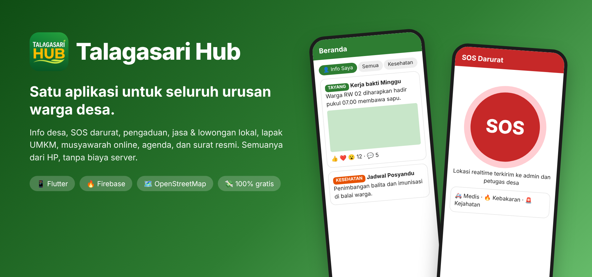
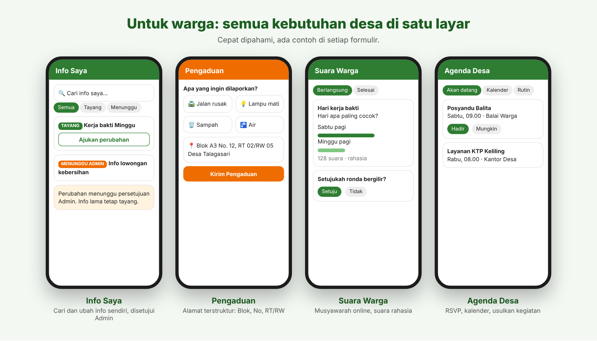
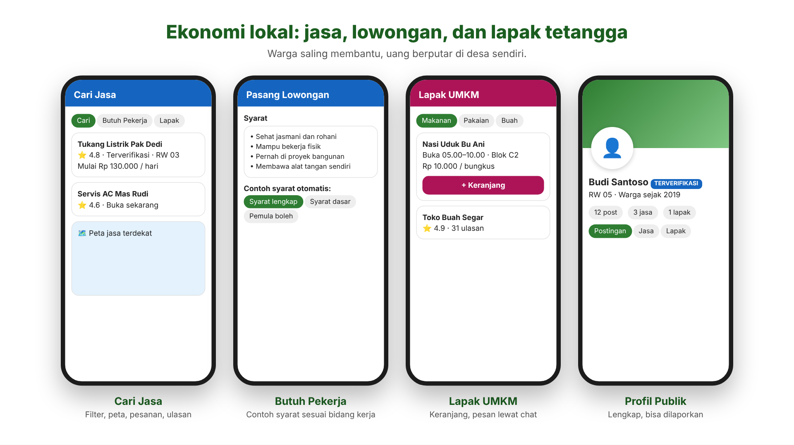
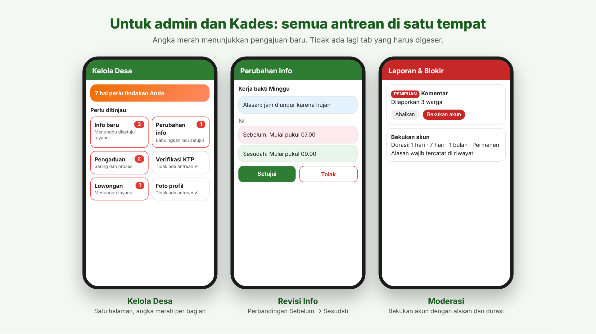
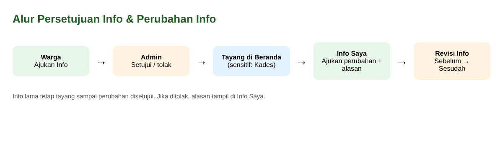
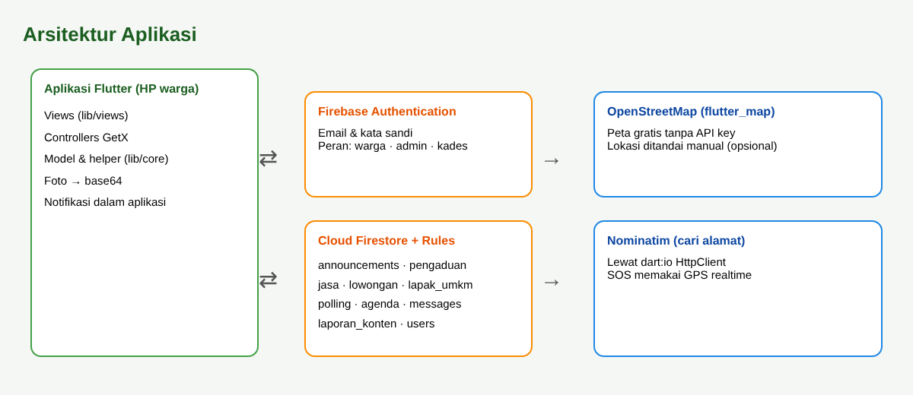

<p align="center">
  
</p>

<p align="center">
  
  
  
  
  
</p>

## 🏘️ Apa ini?

**Talagasari Hub** adalah aplikasi Android untuk **Desa Talagasari (Kec. Cikupa, Kab. Tangerang, Banten)**. Warga, perangkat desa, dan Kepala Desa memakai satu aplikasi untuk urusan sehari-hari: baca info desa, lapor masalah, minta tolong saat darurat, cari tukang, jual beli antar tetangga, ikut musyawarah, sampai mengurus surat.

> Dibuat sebagai proyek skripsi. Berjalan **tanpa server berbayar**: hanya Firebase Auth + Firestore (paket gratis) dan peta OpenStreetMap.

| Masalah di desa | Jawaban di aplikasi |
|---|---|
| Info desa tersebar di grup WhatsApp dan cepat tenggelam | **Beranda** terstruktur, per kategori, dengan reaksi dan komentar |
| Warga bingung harus lapor ke siapa | **Pengaduan** dengan kategori jelas, diproses Admin atau Kades |
| Darurat tapi tidak tahu harus menghubungi siapa | **SOS** satu tombol, lokasi realtime ke petugas |
| Mencari tukang atau pekerja harus tanya orang | **Jasa, Lowongan, Lapak UMKM** milik warga sendiri |
| Keputusan desa hanya didengar yang hadir rapat | **Suara Warga** (musyawarah online) dan **Agenda Desa** |
| Surat harus bolak-balik ke kantor | **Surat online**, cetak PDF, tanda tangan sekali ke kantor |

---

## 👥 Untuk warga

<p align="center"></p>

- **Info ala media sosial**: reaksi emoji, komentar, foto, lokasi di peta (opsional).
- **10 jenis info dengan contoh siap pakai**: Kehilangan, Ditemukan, Dijual, Bantuan, Kabar Duka, Syukuran, **Sebelum-Sesudah (foto digeser)**, Galeri, dan **Tanya Cepat** (polling mini). Pilih warna kartu sendiri.
- **Beranda hidup**: banner geser pilihan Admin, strip Kabar Duka, dan filter cepat per jenis.
- **Info Saya**: cari info yang pernah Anda unggah, lalu ajukan perubahan. Info lama tetap tayang sampai Admin menyetujui.
- **Pengaduan** dan **SOS** untuk masalah umum maupun darurat.
- **Suara Warga** (suara rahasia, hasil per RW) dan **Agenda Desa** (RSVP, kalender). Keduanya bisa **diusulkan warga**, lengkap dengan contoh siap pakai.

## 🛠️ Ekonomi lokal

<p align="center"></p>

| Fitur | Untuk apa | Contoh |
|---|---|---|
| **Cari Jasa** | Tenaga atau keahlian orang | Tukang listrik, servis AC, guru les |
| **Butuh Pekerja** | Memasang lowongan, dengan contoh judul, upah, dan **syarat otomatis** sesuai bidang | "Butuh 2 kuli bangunan harian" |
| **Lapak UMKM** | Berjualan **barang** | Nasi uduk pagi, toko baju, toko buah |

Alamat memakai format resmi desa: **Blok, No. rumah, RT/RW** (wajib). Nama jalan dan kampung opsional.

## 🛡️ Untuk admin dan Kades

<p align="center"></p>

- **Kelola Desa**: satu halaman, kotak per bagian dengan **angka merah** untuk pengajuan baru, ditambah lencana di menu bawah.
- **Revisi Info**: lihat perbandingan Sebelum → Sesudah, setujui atau tolak dengan alasan. Kategori sensitif hanya diputuskan Kades.
- **Moderasi**: laporan konten, pembekuan akun (hari sampai permanen, dengan alasan), riwayat, dan **Aturan Komunitas** yang jelas.

> 🖼️ Gambar di atas adalah **ilustrasi tampilan** untuk menjelaskan fitur. Tangkapan layar asli ada di [docs/screenshots](docs/screenshots).

---

## 🔄 Cara kerja persetujuan

<p align="center"></p>

## 🧱 Teknologi

<p align="center"></p>

**Flutter + GetX** · **Firebase Auth** · **Cloud Firestore + Rules** · **flutter_map (OpenStreetMap)** · Nominatim · foto base64 (tanpa Storage) · notifikasi dalam aplikasi · PDF surat (`pdf`, `printing`).

---

## 🚀 Jalankan dalam 5 menit

```bash
git clone <URL-REPOSITORI-KAMU>
cd talagasari_hub
flutter pub get
flutter run
```

Sebelum dijalankan, siapkan Firebase satu kali:

1. Buat proyek di [Firebase Console](https://console.firebase.google.com), tambahkan aplikasi Android, taruh `google-services.json` di `android/app/`.
2. **Authentication** → aktifkan **Email/Password**.
3. **Firestore Database** → buat database, lalu tab **Rules** → tempel isi `firestore.rules` → **Publish** (ulangi setiap file ini berubah).
4. Salin `android_patch/AndroidManifest.xml` dan isi `android_patch/res/` ke `android/app/src/main/`.
5. Isi nomor kontak dan kop surat di `lib/core/app_contact.dart`.
6. Daftar 2 akun, ubah field `role` di koleksi `users` menjadi `admin` dan `kades`.

Build APK: `flutter build apk --release`.

---

<details>
<summary><b>📂 Struktur proyek</b></summary>

```
lib/
├── controllers/   auth, data, chat, complaint, feedback, village
├── core/          tema, model, helper UI, terjemahan
└── views/         home, info, jasa, lapak, polling, agenda, moderasi,
                   admin (Kelola Desa), complaint, letter, chat, akun
firestore.rules    aturan keamanan per peran (wajib di-deploy)
android_patch/     izin dan ikon Android
docs/img/          gambar README
```
</details>

<details>
<summary><b>🗃️ Koleksi Firestore</b></summary>

`users` · `announcements` (+ `suka`, `komentar`; field `revisi*` untuk perubahan) · `pengaduan` · `jasa` · `lowongan` · `lapak_umkm` (+ `ulasan`) · `polling` (+ `suara`, `komentar`) · `usulan_polling` · `agenda` (+ `hadir`, `komentar`) · `usulan_agenda` · `messages` · `laporan_konten` · `riwayat_moderasi` · `notifications`
</details>

<details>
<summary><b>❓ Pemecahan masalah</b></summary>

| Masalah | Solusi |
|---|---|
| `permission-denied` | Deploy ulang `firestore.rules` terbaru |
| Muncul tautan "requires an index" | Klik tautannya lalu **Create index** |
| Lokasi tidak terbaca | Aktifkan GPS dan izin lokasi |
| Build gagal setelah ganti `pubspec.yaml` | `flutter clean` lalu `flutter pub get` |
</details>

<details>
<summary><b>⚠️ Keterbatasan</b></summary>

Notifikasi hanya muncul di dalam aplikasi (tanpa push saat aplikasi tertutup, karena tanpa Cloud Functions). Foto disimpan di Firestore sehingga ukurannya dibatasi. Pembayaran dilakukan langsung antarwarga.
</details>

---

<p align="center">
  Dibuat untuk warga Desa Talagasari · Lisensi <a href="LICENSE">MIT</a> · Riwayat perubahan di <a href="CHANGELOG.md">CHANGELOG</a> · Panduan rinci di <a href="SETUP.md">SETUP</a>
</p>
